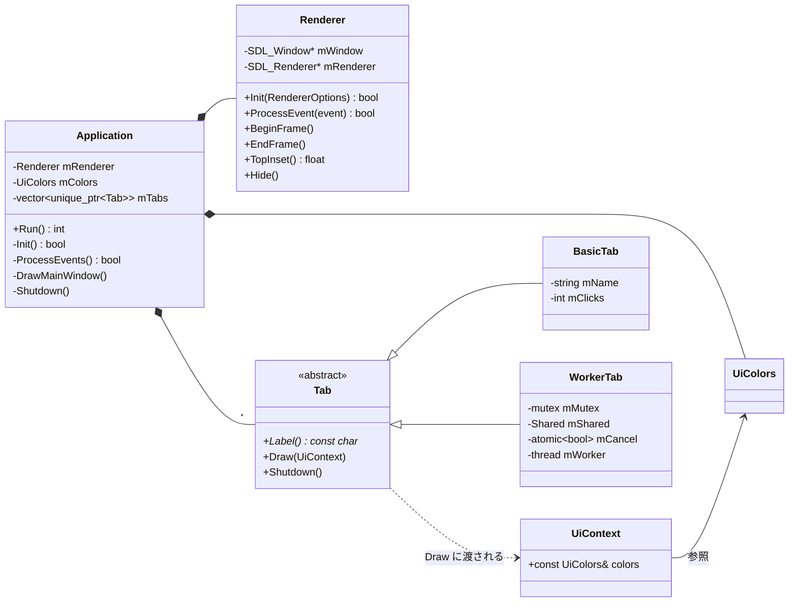

# クラス設計

雛形の土台 (ウィンドウ・メインループ・タブ・ImGui のラッパー) を、どのクラスに分け、なぜそう分けたかをまとめたメモです。

## 全体像



`main()` は `Application` を作って `Run()` を呼ぶだけです。

```cpp
int main(int, char**)
{
    Application app;
    return app.Run();
}
```

## クラスと責任

| クラス | ファイル | 責任 | 知らないこと |
| --- | --- | --- | --- |
| `Application` | [app/application.h](../src/app/application.h) | 状態の持ち主。起動と終了の順番、イベント待ちのループ、画面全体の枠 (タブバー) | SDL と ImGui の初期化の細かいこと、各タブの中身 |
| `Renderer` | [app/renderer.h](../src/app/renderer.h) | SDL のウィンドウとレンダラー、ImGui のコンテキストとバックエンド、フォント、IME のフック。1 フレームの始まりと終わり | 画面に何を描くか (タブを知らない) |
| `RendererOptions` | [app/renderer.h](../src/app/renderer.h) | ウィンドウの作り方 (タイトル・大きさ・フォント・透明にするか) | — |
| `Tab` | [common/tab.h](../src/common/tab.h) | タブの共通の形 (名前・描く・終了) | — |
| `UiContext` | [common/tab.h](../src/common/tab.h) | どのタブにも渡すもの (今は画面の色だけ) | — |
| `BasicTab` / `WorkerTab` | [sample/](../src/sample/) | 見本のタブ。自分の状態を持ち、タブの中身を描く | ほかのタブ、ウィンドウ、メインループ |
| `ui::` のクラスと関数 | [common/widgets.h](../src/common/widgets.h) | ImGui の組で呼ぶ関数を、スコープで閉じるようにする | アプリのこと (ImGui だけに依存する) |
| `RegisterWakeEvent` / `WakeUI` | [common/wake.h](../src/common/wake.h) | ワーカースレッドから、眠っている UI を起こす | — |

## 所有と寿命

- `Application` がすべてを持ちます。タブは `std::vector<std::unique_ptr<Tab>>` で持ち、並べた順にタブバーに出します。
- 複数のタブで共有するもの (例: 読み込んだデータ、通信の状態) は `Application` が持ち、タブには参照で渡します。
  そのときは、タブより先に作られて後に壊れるように、**共有するメンバーを `mTabs` より前に宣言** します (C++ のメンバーは宣言の逆順に壊れます)。`mColors` がその例です。
- タブ自身の状態は、タブのメンバーです。タブが壊れるときに一緒に壊れます。
- `Renderer` は、作ったものだけを覚えておく印 (`mSdlInitialized` など) を持ちます。`Init` が途中で失敗しても、デストラクタが作ったものだけを片付けます。
- `Application` と `Renderer` はコピーを禁止しています。

## 起動と終了の順番

```
Application::Init
  Renderer::Init      … SDL・ウィンドウ・レンダラー・ImGui・フォント・IME
  RegisterWakeEvent   … ワーカーを始める前に
  ApplyUiColors
  タブを作る

Application::Shutdown (Run の最後と、デストラクタから。2 回目は何もしない)
  各タブの Shutdown    … ワーカースレッドを止めて、終わるのを待つ
  (時間のかかる後始末があるなら、Renderer::Hide でウィンドウを先に消してから)

メンバーのデストラクタ (宣言の逆順)
  mTabs → mColors → mRenderer (ImGui → レンダラー → ウィンドウ → SDL_Quit)
```

ワーカースレッドを止めてから状態を壊すので、スレッドが壊れた状態に触ることはありません。
`std::thread` は、終わるのを待たずに壊すとプログラムが止まる (`std::terminate`) ので、スレッドを持つタブは必ず `Shutdown` で `join` します。

## 1 フレームの流れ

```
Application::Run
  ProcessEvents        … Renderer::ProcessEvent (ImGui と IME に渡す)。閉じる操作なら終わる
  Renderer::BeginFrame
  DrawMainWindow
    (どのタブでも見せたいものは、ここでタブバーの前に描く)
    タブバー            … 選ばれているタブの Draw(context) だけを呼ぶ
  Renderer::EndFrame
```

### 省電力のループ

```cpp
bool hasEvent = mFramesToRender > 0
    ? SDL_PollEvent(&event)              // 待たずに確認
    : SDL_WaitEventTimeout(&event, 500); // イベントが来るまで最大 0.5 秒眠る
```

ゲームのように毎フレーム描き続けると、何もしていなくても CPU や GPU を使い続けます。
イベント (キー入力、マウス、`WakeUI`) があったら `mFramesToRender = 3` にして数フレームだけ描き、その後はイベントが来るまで眠ります。
数フレーム続けて描くのは、ImGui ではボタンを押した結果などが次のフレームで画面に出ることがあるためです。

### ワーカースレッドと WakeUI

UI は眠っているので、ワーカースレッドが状態を書き換えても、そのままでは画面に出ません。
ワーカーは書き換えたあとに `WakeUI()` を呼びます。`SDL_PushEvent` で独自のイベントを送るので、眠っている `SDL_WaitEventTimeout` がすぐに戻り、次のフレームが描かれます。

見本の `WorkerTab` は、次の決まりで作っています。

- ワーカーと UI で共有する状態は 1 つの構造体 (`Shared`) にまとめ、`mutex` で守る
- UI は描く前に状態をコピーして、すぐロックを外す (ロックを持ったまま描くと、その間ワーカーが書き込めない)
- 中断は `std::atomic<bool>` のフラグで頼む。ワーカーはループのたびにフラグを見る
- `Shutdown` でフラグを立てて `join` する

## ImGui のラッパー (ui::)

ImGui の組で呼ぶ関数 (`BeginDisabled` / `EndDisabled` など) は、`ui::` のクラスでスコープを抜けると閉じるようにしています。

```cpp
{
    ui::Disabled disabled(!mEditable);
    ImGui::InputText("名前", &mName);
}   // ここで EndDisabled

if (ui::Button("リセット", mClicks > 0))  // 押せないときは薄く表示し、false を返す
    mClicks = 0;
```

| クラス・関数 | 包んでいるもの |
| --- | --- |
| `ui::Disabled` | `BeginDisabled` / `EndDisabled` |
| `ui::Id` | `PushID` / `PopID` |
| `ui::StyleColor` | `PushStyleColor` / `PopStyleColor` (3 つ目の引数が false なら何もしない) |
| `ui::TextWrap` | `PushTextWrapPos` / `PopTextWrapPos` |
| `ui::Child` / `ui::Group` | `BeginChild` / `EndChild`、`BeginGroup` / `EndGroup` |
| `ui::WrappedText` / `WrappedDisabled` / `WrappedColored` | 窓の右端で折り返すテキスト |
| `ui::Button` / `ui::SmallButton` | `enabled` が false なら押せないボタン |
| `ui::ButtonWidth` | ラベルがちょうど収まるボタンの幅 |

- コンストラクタに `[[nodiscard]]` を付けています。`ui::Disabled(true);` のように変数に受けずに書くと、その場で閉じてしまうので警告が出ます。
- 閉じる順番は C++ の規則どおり、宣言の逆順です。`ui::Group` → `ui::Id` → `ui::Child` の順に宣言すれば、`EndChild` → `PopID` → `EndGroup` の順に閉じます。
- `BeginTabItem` や `BeginPopup` のように、戻り値が true のときだけ閉じる関数は包んでいません。`if` の中で閉じる今の書き方のほうが読みやすいためです。
- ボタンなどを、状態を持つクラスにはしていません。ImGui は毎フレーム描き直す (イミディエイトモード) ので、状態はアプリ側の変数だけに持たせます。クラスにすると、同じ状態を 2 か所に持つことになります。

## 設計で決めたこと

| 決めたこと | 理由 |
| --- | --- |
| `Renderer` と `Application` を分ける | `Renderer` だけを見れば SDL と ImGui の扱いが分かり、`Application` だけを見ればアプリの流れが分かるようにするため |
| ウィンドウの作り方は `RendererOptions` で渡す | タイトルやフォントを変えるために `Renderer` の中を読まなくて済むようにするため |
| タブが自分の状態を持つ | タブを足しても `Application` の描く処理が変わらないようにするため |
| タブは `Application` が作って持つ (タブが自分を登録しない) | 持ち主を 1 か所にするため。タブがコンストラクタで自分を登録する作りにすると、本体を持つ場所と一覧の 2 か所で寿命を管理することになる |
| `Tab` と `UiContext` は `common/` に置く (`app/` に置かない) | タブから `app/` を参照しないようにするため。`app/` が各タブを知り、タブは `app/` を知らない |
| `UiContext` を渡す (色を個別の引数にしない) | どのタブにも渡すものが増えたときに、`Tab::Draw` の形を変えずに済むようにするため |
| 終了は `Shutdown()` を明示的に呼び、デストラクタからも呼ぶ | 終了の順番をデストラクタの順番任せにしないため。2 回呼んでも 1 回だけ動く |
| `imgui.ini` を作らない (`io.IniFilename = nullptr`) | ウィンドウは 1 枚で、配置を保存する必要がないため |
| クラスのメンバー名は `mXxx` | ローカル変数や、構造体のメンバーと区別するため |

## 1 画面だけのアプリにするには

タブを 1 つだけにすれば、タブバーに 1 つだけ出ます。タブバーも要らないときは、`Application::DrawMainWindow` の `BeginTabBar` から `EndTabBar` までを、`mTabs[0]->Draw(context);` に置き換えます。
